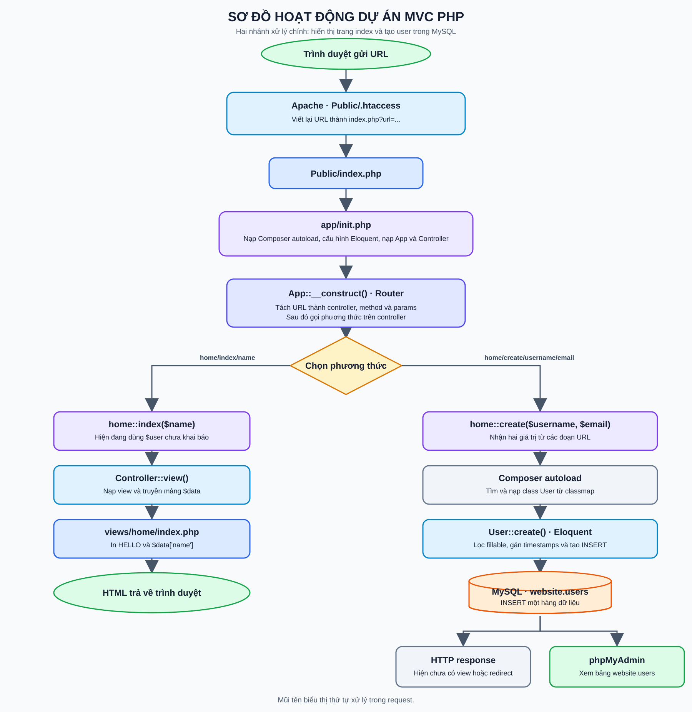

# Giải thích dự án MVC PHP

> Tài liệu này mô tả các file mã nguồn và cấu hình của dự án hiện tại. Phần phụ thuộc trong `vendor/` và file `composer.lock` được bỏ qua.

## Tổng quan cấu trúc

```text
Public/
  .htaccess        Đưa URL ứng dụng qua index.php
  index.php        Điểm vào của ứng dụng
app/
  .htaccess        Tắt danh sách file thư mục app
  init.php         Nạp autoload, database và các class MVC
  database.php     Cấu hình kết nối MySQL và Eloquent
  core/
    App.php        Router: phân tích URL và gọi controller
    Controller.php Hàm tiện ích nạp model và view
  controllers/
    home.php       Xử lý trang home và thao tác tạo user
  models/
    user.php       Model Eloquent đại diện cho bảng users
  views/home/
    index.php      Hiển thị nội dung trang home
composer.json      Khai báo thư viện và autoload model
```

Luồng request bắt đầu ở Apache, đi qua `Public/index.php`, được `App` định tuyến đến controller. Controller dùng model để thao tác với database hoặc truyền dữ liệu đến view.

## `Public/.htaccess`

Apache dùng file này để chuyển những URL không tương ứng với file hoặc thư mục có thật vào front controller là `Public/index.php`.

| Dòng | Giải thích |
|---|---|
| 1 | `Options -MultiViews` tắt MultiViews của Apache, tránh Apache tự dò file dựa trên phần đường dẫn. |
| 2 | `RewriteEngine On` bật chức năng viết lại URL. |
| 3 | Dòng trống để tách nhóm cấu hình. |
| 4 | `RewriteBase` khai báo URL cơ sở của thư mục `Public`. Trong dự án này đường dẫn là `/MVC tu code tay/Public/`. |
| 5 | Dòng trống để dễ đọc. |
| 6 | `RewriteCond %{REQUEST_FILENAME} !-d` chỉ tiếp tục luật khi đường dẫn yêu cầu không phải thư mục có thật. `%{REQUEST_FILENAME}` là đường dẫn file phía máy chủ. |
| 7 | `RewriteCond %{REQUEST_FILENAME} !-f` chỉ tiếp tục khi đường dẫn yêu cầu không phải file có thật. Kết hợp dòng 6, các file tĩnh có thật vẫn được Apache phục vụ trực tiếp. |
| 8 | Dòng trống để tách điều kiện khỏi luật viết lại. |
| 9 | `RewriteRule ^(.+)$ index.php?url=$1 [QSA,L]` bắt phần đường dẫn còn lại, gửi nó vào tham số `url`. `$1` là nội dung được bắt bởi `(.+)`. `QSA` giữ các query string khác đã có. `L` ngừng xét thêm luật khi luật này khớp. |

Ví dụ đường dẫn `home/create/tuan/tuan@example.com` được chuyển nội bộ thành request đến `index.php` với `url=home/create/tuan/tuan@example.com`.

## `Public/index.php`

Đây là điểm vào của mọi request MVC được Apache chuyển hướng.

| Dòng | Giải thích |
|---|---|
| 1 | `<?php` bắt đầu đoạn PHP. |
| 2 | Dòng trống phân cách. |
| 3 | `require_once '../app/init.php'` nạp file khởi động. `..` lùi từ thư mục `Public` về thư mục dự án. `require_once` chỉ nạp file một lần trong một request và gây lỗi nếu file bắt buộc không tồn tại. |
| 4 | Dòng trống phân cách. |
| 5 | `$app = new App()` tạo một đối tượng `App`. Khi tạo, PHP tự gọi hàm khởi tạo `__construct()` của `App`, nơi router xử lý URL. `$app` giữ đối tượng đó trong suốt request này. |

## `app/init.php`

File này nạp các thành phần theo thứ tự cần thiết. Autoloader phải được đăng ký trước khi cấu hình dùng class của Illuminate.

| Dòng | Giải thích |
|---|---|
| 1 | Bắt đầu PHP. |
| 2 | Dòng trống phân cách. |
| 3 | Nạp `vendor/autoload.php`. File Composer đăng ký cách tự tìm class của thư viện và model. Khi PHP cần class chưa được nạp, Composer tìm file tương ứng rồi nạp nó. |
| 4 | Dòng trống. |
| 5 | Nạp và chạy `database.php`, tạo cấu hình database và khởi động Eloquent. |
| 6 | Dòng trống. |
| 7 | Nạp định nghĩa class `App`, router của dự án. |
| 8 | Dòng trống. |
| 9 | Nạp định nghĩa class `Controller`, class cha của các controller. |
| 10 | Dòng trống cuối file. |

## `composer.json`

File JSON này khai báo package mà dự án cần và thư mục model để Composer tạo autoload.

| Dòng | Giải thích |
|---|---|
| 1 | Mở đối tượng JSON ở cấp cao nhất. |
| 2 | Bắt đầu nhóm package bắt buộc `require`. |
| 3 | Yêu cầu `illuminate/database` phiên bản tương thích từ `12.0.0` đến trước `13.0.0`. Package này cung cấp Eloquent ORM và các thành phần kết nối database. Dấu `^` cho phép cập nhật tương thích trong cùng major version 12. |
| 4 | Đóng nhóm `require`, dấu phẩy cho biết phía sau còn cấu hình khác. |
| 5 | Bắt đầu nhóm cấu hình tự nạp class `autoload`. |
| 6 | Bắt đầu kiểu autoload `classmap`. Composer sẽ quét các file khi tạo lại autoload và lập bản đồ tên class tới file chứa class. |
| 7 | Thư mục `app/models/` chứa các model, ví dụ class `User`. |
| 8 | Đóng danh sách `classmap`. |
| 9 | Đóng nhóm `autoload`. |
| 10 | Đóng đối tượng JSON. |

Sau khi thêm class hoặc file model mới với kiểu `classmap`, cần chạy `composer dump-autoload` để cập nhật bản đồ class. Lệnh đó không tạo database hoặc bảng, nó cập nhật dữ liệu autoload trong `vendor/composer/`.

## `app/database.php`

File này thiết lập kết nối MySQL và chỉ cho Eloquent biết bộ quản lý kết nối nào cần sử dụng.

| Dòng | Giải thích |
|---|---|
| 1 | Bắt đầu PHP. |
| 2 | Dòng trống. |
| 3 | Import class `Illuminate\Database\Capsule\Manager` và đặt bí danh ngắn là `Capsule`. |
| 4 | Dòng trống. |
| 5 | Tạo đối tượng `Capsule` và gán vào biến cục bộ `$capsule`. Biến này dùng để cấu hình database trong file này. |
| 6 | Dòng trống. |
| 7 | Gọi `addConnection()` để đăng ký một cấu hình kết nối. Mảng `[...]` chứa các tuỳ chọn. |
| 8 | `driver` chọn MySQL làm hệ quản trị cơ sở dữ liệu. |
| 9 | `host` là máy chủ MySQL. `127.0.0.1` có nghĩa là chạy trên cùng máy. |
| 10 | `port` là cổng kết nối MySQL, thường là `3306`. |
| 11 | `database` chọn database tên `website`. |
| 12 | `username` ở đây là tài khoản MySQL `root`, khác với cột `username` lưu thông tin người dùng. |
| 13 | `password` là mật khẩu kết nối. Chuỗi rỗng nghĩa là cấu hình hiện tại không gửi mật khẩu. |
| 14 | `charset` đặt bộ ký tự cho kết nối. `utf8mb4` hỗ trợ Unicode đầy đủ. |
| 15 | `collation` chọn quy tắc so sánh và sắp xếp ký tự cho kết nối. `_ci` thường biểu thị không phân biệt hoa thường. |
| 16 | `prefix` là tiền tố thêm vào tên bảng. Chuỗi rỗng giữ tên bảng mặc định như `users`. |
| 17 | Đóng mảng cấu hình và lời gọi `addConnection()`. |
| 18 | Dòng trống. |
| 19 | `setAsGlobal()` đặt Capsule làm instance dùng chung để các lời gọi tĩnh có thể tìm được cấu hình. |
| 20 | `bootEloquent()` gắn bộ phân giải kết nối cho Eloquent. Eloquent sẽ dùng nó khi model thực hiện truy vấn. |

## `app/core/App.php`

Class `App` là router. Nó đọc URL, chọn controller và phương thức, rồi truyền những phần còn lại của URL làm tham số.

| Dòng | Giải thích |
|---|---|
| 1 | Bắt đầu PHP. |
| 2 | Dòng trống. |
| 3 | Khai báo class `App`. |
| 4 | Mở thân class. |
| 5 | `$controller` ban đầu là chuỗi `'home'`, controller mặc định. Trong constructor, thuộc tính này được gán lại thành đối tượng controller sau khi khởi tạo. `protected` giới hạn truy cập trong class và class con. |
| 6 | Dòng trống. |
| 7 | `$method` chứa tên phương thức mặc định là `'index'`. |
| 8 | Dòng trống. |
| 9 | `$params` chứa danh sách đối số, mặc định là mảng rỗng. |
| 10 | Dòng trống. |
| 11 | Khai báo hàm khởi tạo `__construct()`. PHP tự gọi hàm này khi chạy `new App()`. |
| 12 | Mở thân constructor. |
| 13 | Gọi `parseURL()` và lưu mảng URL trả về vào biến cục bộ `$url`. |
| 14–16 | Các dòng trống để phân cách khối lệnh. |
| 17 | Ghép đường dẫn `../app/controllers/`, phần đầu URL `$url[0]` và đuôi `.php`, sau đó kiểm tra file có tồn tại bằng `file_exists()`. Dấu `.` trong PHP dùng để nối chuỗi. |
| 18 | Nếu controller theo URL có file, lưu tên đó vào thuộc tính `$this->controller`. `$this` trỏ tới đối tượng `App` hiện tại. |
| 19 | Xoá `$url[0]` vì nó đã được dùng làm tên controller. |
| 20 | Đóng khối `if`. |
| 21 | Nạp file controller đã chọn. Nếu URL không chọn được controller khác thì dùng controller mặc định `home`. |
| 22 | Tạo đối tượng controller từ tên class trong `$this->controller`. Sau lệnh này thuộc tính giữ đối tượng, không còn là chuỗi tên class. |
| 23 | Kiểm tra URL có phần tử `$url[1]`, dự kiến là tên phương thức hay không. |
| 24 | `method_exists()` xác nhận phương thức đó có trong controller trước khi gọi. |
| 25 | Gán tên phương thức hợp lệ vào `$this->method`. |
| 26 | Xoá phần tử tên phương thức khỏi mảng URL. |
| 27–28 | Đóng hai khối `if`. |
| 29 | Nếu `$url` còn phần tử, `array_values()` đánh lại chỉ số từ 0. Nếu rỗng hoặc không có giá trị, gán mảng rỗng. Kết quả được lưu làm tham số `$this->params`. |
| 30 | `call_user_func_array()` gọi phương thức trên đối tượng controller, truyền từng phần tử trong `$params` thành một đối số. |
| 31 | Đóng constructor. |
| 32 | Dòng trống. |
| 33 | Khai báo hàm `parseURL()`. |
| 34 | Mở hàm. |
| 35 | Kiểm tra request có tham số `url` trong mảng `$_GET` không. |
| 36 | `rtrim()` bỏ dấu `/` ở cuối. `filter_var(..., FILTER_SANITIZE_URL)` lọc chuỗi theo bộ lọc URL của PHP. `explode('/', ...)` tách chuỗi tại dấu `/`. Kết quả được trả về dưới dạng mảng. |
| 37 | Đóng `if`. |
| 38 | Đóng hàm. Nếu không có `url`, hàm kết thúc mà không trả mảng. |
| 39–40 | Đóng class. |

Với URL `home/create/tuan/tuan@example.com`, `$url` ban đầu là `['home', 'create', 'tuan', 'tuan@example.com']`. Router lấy `home` làm controller, `create` làm phương thức và truyền `tuan`, `tuan@example.com` vào phương thức đó.

## `app/core/Controller.php`

Class `Controller` cung cấp hai hàm chung cho controller con: nạp model và nạp view.

| Dòng | Giải thích |
|---|---|
| 1 | Bắt đầu PHP. |
| 2 | Dòng trống. |
| 3 | Khai báo class `Controller`. |
| 4 | Mở thân class. |
| 5 | Khai báo phương thức `model($model)`. `$model` là tên class model cần tạo. |
| 6 | Mở phương thức. |
| 7 | Ghép tên model thành đường dẫn `../app/models/<tên>.php` rồi nạp file. |
| 8 | Tạo đối tượng của class có tên trong `$model` và trả về cho bên gọi. Ví dụ `$this->model('User')` trả về một đối tượng `User`. |
| 9 | Đóng phương thức `model()`. |
| 10 | Dòng trống. |
| 11 | Khai báo `view($view, $data = [])`. `$view` là đường dẫn view tương đối. `$data` là mảng dữ liệu gửi tới view, mặc định rỗng. |
| 12 | Mở phương thức. |
| 13 | Nạp file view tương ứng. Ví dụ `'home/index'` trở thành `../app/views/home/index.php`. Vì file được nạp trong phạm vi phương thức này, view truy cập được biến `$data`. |
| 14 | Đóng phương thức `view()`. |
| 15 | Đóng class. |

## `app/controllers/home.php`

Class `home` xử lý các URL có controller là `home`. Nó kế thừa `Controller`, nên dùng được `$this->view()` và `$this->model()`.

| Dòng | Giải thích |
|---|---|
| 1 | Bắt đầu PHP. |
| 2 | Dòng trống. |
| 3 | Khai báo class `home` kế thừa `Controller`. `extends` thể hiện quan hệ kế thừa. |
| 4–5 | Mở class và dòng trống định dạng. |
| 6 | Khai báo phương thức `index($name = '')`. `$name` nhận tham số từ URL nếu router truyền vào. Nếu thiếu thì dùng chuỗi rỗng. |
| 7 | Mở phương thức `index()`. |
| 8 | Dòng trống. |
| 9 | Gọi view `home/index` và truyền mảng có khóa `'name'`. Tuy nhiên giá trị đang lấy từ `$user->name`, trong khi `$user` chưa được khởi tạo ở phương thức này. `$name` được nhận ở dòng 6 nhưng chưa dùng. Vì vậy trang index có thể báo biến chưa định nghĩa. |
| 10–11 | Dòng trống. |
| 12 | Đóng phương thức `index()`. |
| 13 | Dòng trống. |
| 14 | Khai báo phương thức `create($username = '', $email = '')`. Hai tham số nhận phần thứ ba và thứ tư của URL sau tên controller và phương thức. |
| 15 | Mở phương thức `create()`. |
| 16 | Gọi phương thức tĩnh `create()` trên model `User`, truyền vào mảng thuộc tính cần lưu. Composer tự nạp class `User` khi cần dựa trên classmap. |
| 17 | Gán biến `$username` cho trường database `username`. |
| 18 | Gán biến `$email` cho trường database `email`. |
| 19 | Đóng mảng và lời gọi `User::create()`. |
| 20 | Đóng phương thức `create()`. Không có lệnh `return`, redirect hay render view ở đây, nên phản hồi HTTP thành công hiện có thể là trang trắng. |
| 21 | Dòng trống. |
| 22 | Đóng class `home`. |

## `app/models/user.php`

Class `User` là model Eloquent, đại diện mặc định cho bảng `users`.

| Dòng | Giải thích |
|---|---|
| 1 | Bắt đầu PHP. |
| 2 | Dòng trống. |
| 3 | Import class Eloquent `Model`, đặt bí danh là `Eloquent`. |
| 4 | Dòng trống. |
| 5 | Khai báo class `User` kế thừa `Eloquent`. Thừa hưởng khả năng truy vấn và lưu dữ liệu. |
| 6 | Mở thân class. |
| 7 | Khai báo thuộc tính công khai `$name`, hiện không được gán giá trị và không được sử dụng khi tạo record trong `create()`. |
| 8 | Dòng trống. |
| 9 | `$timestamps` điều khiển việc Eloquent tự ghi `created_at` và `updated_at`. Mảng hiện tại không rỗng nên được coi là bật. Các tên cột trong mảng này không dùng để cấu hình tên timestamp. Để bật rõ ràng, giá trị thông thường là `true`, cũng là mặc định của Eloquent. |
| 10 | Dòng trống. |
| 11 | `$fillable` liệt kê các trường được phép gán hàng loạt qua `User::create()`. Vì vậy `username` và `email` được đưa vào model. |
| 12 | Đóng class. |

Khi không khai báo bảng khác, Eloquent suy ra `User` dùng bảng `users`, khóa chính `id`, và tự xử lý timestamp theo tên mặc định. Các cột đó cần tồn tại trong cấu trúc bảng MySQL.

## `app/views/home/index.php`

File view này có một dòng PHP ngắn.

| Dòng | Giải thích |
|---|---|
| 1 | `HELLO, ` là chữ xuất hiện trên trang. `<?= ... ?>` là cách viết ngắn của `echo`. `$data['name']` lấy giá trị theo khóa `'name'` từ mảng truyền vào bởi `$this->view()`. Nếu controller truyền `['name' => 'Tuan']`, nội dung được in là `HELLO, Tuan`. |

## `app/.htaccess`

| Dòng | Giải thích |
|---|---|
| 1 | `Options -Indexes` tắt việc Apache tự tạo danh sách file khi truy cập một thư mục trong `app`. Đây là tuỳ chọn bảo vệ hiển thị danh sách thư mục. |

## Các biến và thuộc tính quan trọng

| Tên | Phạm vi và mục đích |
|---|---|
| `$app` | Biến ở `Public/index.php`, giữ router `App` trong request. |
| `$capsule` | Biến ở `database.php`, giữ đối tượng cấu hình database và Eloquent. |
| `$controller` | Thuộc tính của `App`, trước hết chứa tên controller, rồi chứa đối tượng controller. |
| `$method` | Thuộc tính `App` giữ tên phương thức cần gọi. |
| `$params` | Thuộc tính `App` giữ các đối số còn lại của URL. |
| `$url` | Mảng các phần URL; trong `parseURL()` là biến cục bộ, trong constructor là biến cục bộ nhận kết quả trả về. |
| `$model` | Tham số của `Controller::model()`, chứa tên class model. |
| `$view` | Tham số của `Controller::view()`, chứa đường dẫn view tương đối. |
| `$data` | Mảng dữ liệu controller gửi cho view. |
| `$name` | Tham số của `home::index()`, hiện chưa được dùng đúng trong phần thân hàm. |
| `$username`, `$email` | Tham số của `home::create()`, nhận giá trị từ URL rồi được gửi cho model. |
| `$fillable` | Thuộc tính của model khai báo các cột cho phép gán hàng loạt. |
| `$timestamps` | Thuộc tính của model bật hoặc tắt việc Eloquent tự gán thời điểm tạo và cập nhật. |

## Cách `User::create()` đi tới MySQL

1. Router truyền các đoạn URL sau `create` vào `$username` và `$email`.
2. PHP gặp tên class `User`. Autoloader của Composer tra classmap được tạo từ mục `app/models/` trong `composer.json` rồi nạp `user.php` nếu class chưa được nạp.
3. `User` thừa kế Eloquent. Lời gọi tĩnh `create()` được chuyển tới cơ chế tạo model/truy vấn của Eloquent.
4. Eloquent chỉ nhận các trường `username` và `email` vì model khai báo `$fillable` như vậy.
5. Eloquent tự thêm hai timestamp vì `$timestamps` đang bật.
6. Eloquent suy ra bảng `users` và dùng kết nối `website` đã cấu hình trong `database.php`.
7. Eloquent gửi câu lệnh `INSERT` tới MySQL. Dòng mới sau đó xuất hiện trong phpMyAdmin tại `website` → `users`.

Nếu autoload không tìm thấy class, PHP dừng trước bước tạo câu SQL. Nếu class được nạp nhưng MySQL hoặc bảng/cột có vấn đề, lỗi lúc đó sẽ là lỗi kết nối hoặc truy vấn database.

## Sơ đồ hoạt động dự án


